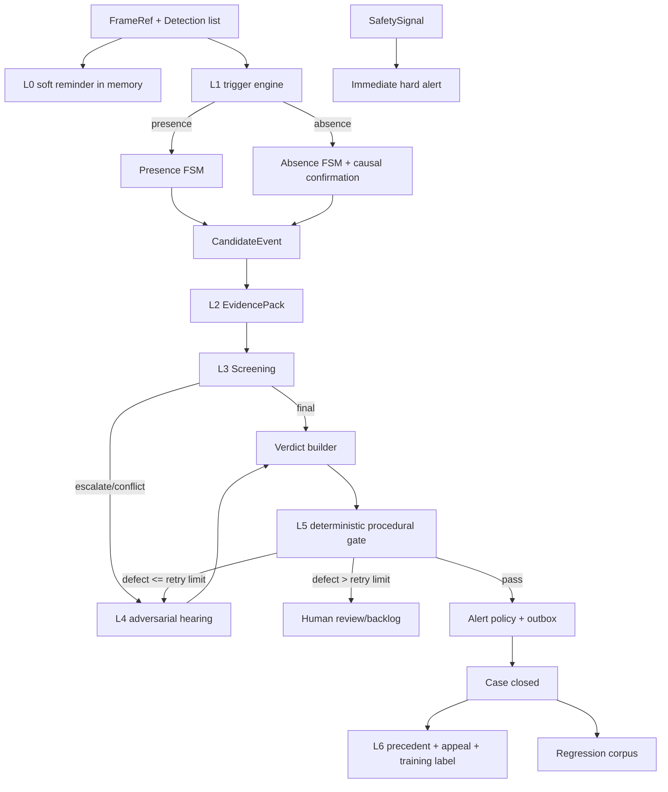

# LabCourt Agent-Executable Build Specification

**文档版本**：0.1.0  
**日期**：2026-07-25  
**状态**：可实施设计；用于指导 coding agent 分阶段完成可运行的 LabCourt 纵向切片  
**需求基线**：`request.md`  
**主要读者**：负责 vibe coding 的软件开发 agent、代码审查者、实验室安全产品负责人

---

## 0. 使用说明

本文不是愿景稿，也不是让 agent 一次性生成全部代码的提示词。它把 LabCourt 拆成可独立验证的模块、数据契约、状态机、接口、测试和里程碑。

在本文中：

- **MUST / 必须**：不满足即不接受实现。
- **SHOULD / 应当**：除非有可记录的工程理由，否则必须满足。
- **MAY / 可以**：可选能力，不得阻塞主流程。
- 所有性能数字均是**待真实部署数据验证的目标**，不是已证实结论。
- coding agent 必须按里程碑顺序工作，每次只实现一个可验证增量；禁止一口气搭建完整微服务集群。

### 0.1 一句话目标

构建一个本地优先、契约驱动、可离线复现的化学实验室违规案件流水线：它能从预计算检测或视频输入生成候选案件，建立证据包，经初审、会审、确定性程序审查、告警策略、申诉与判例闭环，最终输出结构化 JSON 与可审计 HTML 报告。

### 0.2 纵向切片完成标准

第一阶段完成时，在**无 GPU、无网络、无真实摄像头、无云模型**的开发机上，必须能够运行：

```bash
make demo
```

并得到一个包含至少 16 个预置端到端场景的 `runs/<run_id>/` 目录，场景覆盖：存在型成立/不成立、缺失型真违规、检测漏检但实际已佩戴、观测不足、伪造证据引用、VLM 不可用、申诉改判与回归门禁。

---

## 1. 用户意图与产品边界

### 1.1 真正要解决的问题

LabCourt 的核心不是“再做一个 PPE 检测器”，而是建立一套能消化感知噪声的裁决系统。系统必须把三类职责拆开：

1. VLM 负责主观语义判断，例如是否佩戴护目镜、动作是否构成倾倒。
2. 确定性代码负责客观可验证事项，例如帧、轨迹、时长、人数、区域、证据引用是否真实。
3. 规则引擎负责政策执行，例如告警等级、冷却、累犯和通知对象。

用户期待的结果不是一句“检测到违规”，而是一份能说明证据、理由、适用判例、程序检查结果和申诉状态的案件记录。

### 1.2 推荐实现路线

本规格选择 **“模块化单体核心 + 隔离模型进程 + 端口适配器”**：

- 核心业务、契约、状态机、SQLite 存储、CLI 和静态报告放在一个 Python 项目中。
- 视觉检测、姿态、VLM 推理分别通过接口接入；真实重模型可以运行在独立进程或容器中。
- 默认开发路径只用预计算检测与 Fake VLM，保证所有业务逻辑可在 CPU 上测试。

未选择的方案：

| 方案 | 优点 | 缺点 | 结论 |
|---|---|---|---|
| 单进程研究脚本 | 最快出结果 | 模型依赖冲突、不可测试、状态不可审计 | 仅可用于一次性实验，不作为主实现 |
| 模块化单体 + 模型隔离 | 业务边界清晰、开发成本可控、可逐步替换模型 | 需要认真设计接口与 manifest | **采用** |
| Kafka/微服务/分布式工作流 | 横向扩展能力强 | 早期复杂度远高于价值，难以 vibe coding | 生产规模证明需要后再引入 |

### 1.3 第一阶段必须实现的范围

第一阶段是可运行的纵向切片，不是完整生产部署。必须实现：

- 契约层：Pydantic 模型、枚举、JSON Schema 导出、配置校验。
- 确定性时间基准、ID、几何、区域与关联逻辑。
- L0 软提醒旁路的内存实现，且不写持久记录。
- L1 存在型与缺失型状态机，支持预计算检测流。
- L2 视频帧读取、证据裁切、证据引用闭包校验。
- L3 初审路由，支持 Fake VLM 与 OpenAI-compatible VLM 适配器。
- L4 检察官、辩护人、法官编排和受限主动取证。
- L5 六类程序审查、发回重审、转人工与告警策略。
- L6 SQLite 判例库、融合检索、冲突状态、申诉改判。
- 训练标签采集与导出，但不要求真实再训练。
- 回归重放与翻转报告。
- CLI、JSONL 工件、静态 HTML 报告、完整测试夹具。

### 1.4 第一阶段明确不做

以下项目不得阻塞纵向切片：

- 真实 RTSP 长连接、摄像头发现、NVR 集成。
- 自研人脸识别、跨摄像头 ReID、人员画像。
- 生产级账号体系；第一阶段只允许本机/内网开发模式。
- 真实火焰或烟雾“安全认证”算法。
- 真实检测器训练、LoRA 训练或灰度发布平台。
- Kafka、Kubernetes、分布式向量数据库。
- 将系统输出直接用于纪律处分。
- 未经真实数据验证的准确率、成本或延迟承诺。

---

## 2. 调研结论与必须修正的假设

以下结论用于把需求稿变成可可靠编码的规格。它们不是对原设计目标的否定，而是对实现边界的收紧。

### 2.1 VLM 选型必须配置化

截至本文日期，Qwen3-VL 已提供 2B、4B、8B、30B-A3B、32B 等开放权重版本，并支持 Transformers、vLLM 等部署方式。因此：

- 初审默认配置建议从 Qwen3-VL-4B 或 8B 中实测选择，而不是把旧的 7B 型号写死。
- 会审可选 Qwen3-VL-30B-A3B、32B 或云端 API。
- `provider/model/revision/quantization` 必须属于运行 manifest，不得写死在业务代码。
- Fake VLM 必须是默认测试 provider。

### 2.2 YOLO-World 可用，但必须隔离依赖并过许可证审查

YOLO-World V2.1 仍是实时开放词表检测的合理候选，但官方代码依赖 OpenMMLab 栈，且项目许可证为 GPL-3.0。实现要求：

- 核心应用不得直接 import YOLO-World。
- `YOLOWorldDetector` 必须通过独立进程/容器服务接入。
- 商业部署前必须完成 GPL 义务与模型权重许可证审查。
- 若许可证或兼容性不符合项目要求，可替换为 Grounding DINO 或已取得商业授权的检测器；业务接口不变。

### 2.3 检测器反哺不得把“LoRA”写成唯一方案

YOLO-World 官方公开的训练路径包括普通微调、prompt tuning 和 reparameterized fine-tuning；通用 LoRA 并非其默认官方路径。因此：

- 第一阶段只实现训练标签采集、质量分级与数据集导出。
- `DetectorTrainer` 是可插拔接口。
- 训练方式由具体检测器适配器决定，不得在领域层写死 LoRA。

### 2.4 “阈值后恢复检出即可抑制”存在因果漏洞

若操作者真实未佩戴 10 秒，并在达到阈值后才补戴，未来 10 秒内会出现“恢复检出”。若据此撤销案件，会漏掉已经发生的违规。

生产默认策略必须是 `STRICT_CAUSAL`：

- 只有属于涉嫌违规区间本身、但因异步推理延迟而晚到的反证，才可确定性抑制事件。
- 阈值之后的新检出只表示“违规已结束/已纠正”，不得自动抹去过去区间。
- 原需求中的未来恢复抑制保留为 `SOURCE_COMPAT` 实验模式，只能用于离线消融，不能成为生产默认。

### 2.5 确定性安全底线必须来自可靠信号源

“纯帧差”是确定性算法，但确定性不等于可靠，更不等于安全认证。无人值守加热若依赖人体检测，也无法在“检测器全部故障”时保持安全底线。

因此硬告警必须消费统一的 `SafetySignal`：

- 允许来源：物理传感器、PLC、经过现场验证的确定性算法、人工紧急按钮。
- 视频启发式信号在未验证前只能形成候选事件，不能标记为安全底线。
- 第一阶段用 fixture 模拟安全信号，不声称已经实现生产级烟火检测。

### 2.6 “同一视频重跑完全一致”需要定义复现模式

云 API、GPU 算子和生成模型即使 temperature=0，也不保证每次字节级相同。系统必须区分：

- `REPLAY_LOCKED`：复用已保存的模型响应；案件的语义内容、裁决方向与 `semantic_case_hash` 必须完全一致，新的运维时间戳不参与该 hash。
- `REINFER_PINNED`：固定模型、prompt、参数重新推理，要求报告差异，不承诺字节级一致。
- `UPGRADE_REGRESSION`：用新版本重跑并计算翻转率。

生产审计所说的“可复现”默认指 `REPLAY_LOCKED`；新模型评估使用后两种模式。

### 2.7 自动训练标签必须区分弱标签与人工真值

“检测器沉默 + VLM 判定已佩戴”不是地面真值，只是弱标签。训练标签必须分级：

- `WEAK_AUTO`：机器闭环产生，默认不进入正式训练集。
- `CONSENSUS_REVIEWED`：多模型一致并经抽检，可低权重使用。
- `HUMAN_CONFIRMED`：人工复核。
- `APPEAL_CONFIRMED`：申诉改判产生，最高优先级。

第一阶段导出时默认只包含后两类。

### 2.8 图像最小化与 PPE 判断存在张力

完全模糊脸部可能同时抹掉护目镜证据。实现必须提供隐私策略，而不是简单调用全脸高斯模糊：

- 本地 VLM 可使用不落盘的临时原始头部裁切。
- 云端只允许最小头部/PPE 区域，默认遮蔽无关脸部区域。
- 持久证据使用 `PPE_PRESERVING_REDACTION`，并把隐私变换版本写入 manifest。
- 隐私变换对 PPE 判断准确率的影响必须单独评测。

---

## 3. 不可破坏的系统公理

1. **安全底线不依赖 VLM。** 已认证的硬安全信号必须先于任何 VLM 流程发出紧急告警。
2. **AI 提议，代码守门。** 模型可以判断语义，不得决定证据是否存在、坐标是否合法、人数和时长是多少。
3. **帧号是权威时间。** 领域代码不得读取系统墙钟来计算案件时长。
4. **存在型与缺失型分流。** 每个违规类型必须静态绑定 `EvidenceClass`，启动时校验完整性。
5. **预防与问责分流。** L0 不建案、不写像素、不持久化轨迹标识。
6. **证据闭包。** 判决中引用的每个 frame/crop/precedent/tool result 必须真实存在于当前案件版本。
7. **因果不倒置。** 未来发生的合规行为不得自动抹去已经成立的过去违规区间。
8. **无脸识别。** track ID 只表示单摄像头、单 tracker epoch 内的算法轨迹，不等同真实身份。
9. **模型失败可降级。** VLM 不可用时案件进入积压或人工；硬安全告警不受影响。
10. **外部能力可替换。** 领域层与应用层只依赖端口接口，不直接依赖具体模型包。
11. **不保存隐藏思维链。** 只保存结构化主张、证据引用、简洁理由与裁决摘要。
12. **性能结论必须实测。** 未经过封存测试集的数据不得写入验收结论。

---

## 4. 总体架构

### 4.1 进程边界

```text
┌─────────────────────────────────────────────────────────────┐
│ Core App（Python 3.11）                                     │
│ contracts / domain / application / sqlite / cli / report   │
└──────────────┬──────────────────┬───────────────────────────┘
               │ ports            │ ports
      ┌────────▼─────────┐  ┌─────▼────────────────┐
      │ Perception Worker │  │ VLM / Embedding      │
      │ detector/tracker  │  │ local or cloud       │
      │ pose/redetect     │  │ OpenAI-compatible API│
      └───────────────────┘  └──────────────────────┘
```

第一阶段 Core App 可以直接使用 `PrecomputedPerceptionAdapter` 和 `FakeVLMClient`。真实模型集成必须保持为可选 extra 或独立服务。

### 4.2 主数据流



### 4.3 依赖规则

- `contracts` 不依赖项目内任何其他包。
- `domain` 只依赖 `contracts` 与 Python 标准库。
- `application` 依赖 `contracts`、`domain`、`ports`。
- `adapters` 实现 `ports`，可以依赖第三方包。
- `services` 负责组装依赖，不包含领域规则。
- 任意新增字段先修改契约、JSON Schema 快照和迁移，再修改业务代码。
- 禁止 `domain` 或 `application` import `cv2`、`torch`、`transformers`、具体云 SDK。

---

## 5. 推荐仓库结构

```text
labcourt/
├── AGENTS.md
├── README.md
├── pyproject.toml
├── uv.lock
├── Makefile
├── configs/
│   ├── default.yaml
│   ├── demo.yaml
│   └── policies/
│       └── laboratory-v1.yaml
├── prompts/
│   ├── screening_presence_v1.jinja
│   ├── screening_absence_v1.jinja
│   ├── prosecutor_v1.jinja
│   ├── defender_v1.jinja
│   └── judge_v1.jinja
├── schemas/                      # 从 Pydantic 生成并提交版本库
├── src/labcourt/
│   ├── contracts/
│   │   ├── base.py
│   │   ├── enums.py
│   │   ├── geometry.py
│   │   ├── manifests.py
│   │   ├── frames.py
│   │   ├── detections.py
│   │   ├── events.py
│   │   ├── evidence.py
│   │   ├── screening.py
│   │   ├── verdicts.py
│   │   ├── cases.py
│   │   ├── precedents.py
│   │   ├── appeals.py
│   │   ├── alerts.py
│   │   ├── training.py
│   │   └── config.py
│   ├── ports/
│   │   ├── frame_source.py
│   │   ├── perception.py
│   │   ├── safety.py
│   │   ├── frame_store.py
│   │   ├── vlm.py
│   │   ├── embeddings.py
│   │   ├── precedents.py
│   │   ├── alerts.py
│   │   ├── backlog.py
│   │   └── trainer.py
│   ├── domain/
│   │   ├── canonical.py
│   │   ├── ids.py
│   │   ├── timebase.py
│   │   ├── zones.py
│   │   ├── association.py
│   │   ├── observability.py
│   │   ├── presence_fsm.py
│   │   ├── absence_fsm.py
│   │   ├── screening_router.py
│   │   ├── procedural_gate.py
│   │   ├── alert_policy.py
│   │   ├── precedent_policy.py
│   │   └── appeal_policy.py
│   ├── application/
│   │   ├── orchestrator.py
│   │   ├── ingest.py
│   │   ├── build_evidence.py
│   │   ├── screen_case.py
│   │   ├── deliberate_case.py
│   │   ├── review_verdict.py
│   │   ├── close_case.py
│   │   ├── retry_backlog.py
│   │   ├── resolve_appeal.py
│   │   ├── collect_training.py
│   │   └── run_regression.py
│   ├── adapters/
│   │   ├── frame/
│   │   │   ├── opencv_video.py
│   │   │   └── synthetic.py
│   │   ├── perception/
│   │   │   ├── precomputed.py
│   │   │   ├── yolo_world_http.py
│   │   │   ├── bytetrack.py
│   │   │   └── rtmpose_http.py
│   │   ├── vlm/
│   │   │   ├── fake.py
│   │   │   └── openai_compatible.py
│   │   ├── embedding/
│   │   │   ├── fake.py
│   │   │   ├── bge_m3.py
│   │   │   └── open_clip.py
│   │   ├── storage/
│   │   │   ├── sqlite.py
│   │   │   ├── filesystem.py
│   │   │   └── audit_log.py
│   │   └── alert/
│   │       ├── jsonl.py
│   │       └── webhook.py
│   ├── reports/
│   │   └── static_html.py
│   ├── services/
│   │   └── api.py
│   └── cli.py
├── tests/
│   ├── unit/
│   ├── contract/
│   ├── integration/
│   ├── e2e/
│   ├── regression/
│   └── fixtures/
│       ├── videos/
│       ├── detections/
│       ├── vlm_responses/
│       ├── scenarios/
│       └── precedents/
├── scripts/
│   ├── export_schemas.py
│   ├── validate_artifacts.py
│   └── build_demo_fixtures.py
├── docker/
│   ├── perception/
│   └── qwen-vllm/
└── docs/
    ├── architecture-decisions/
    ├── compliance-checklist.md
    └── model-license-register.md
```

---

## 6. 契约层

### 6.1 通用约定

- Python：3.11。
- 数据模型：Pydantic v2，`extra="forbid"`。
- JSON Schema：Draft 2020-12，由代码自动生成；禁止手工维护第二份 schema。
- 枚举在 JSON 中使用大写 snake case 字符串。
- 所有时间区间使用闭开区间 `[start_frame, end_frame_exclusive)`。
- bbox 使用整数像素坐标 `XYXY` 闭开区间：`0 <= x1 < x2 <= width`、`0 <= y1 < y2 <= height`。
- adapter 边界将 bbox 四舍五入为整数，将 score 截断到 6 位小数，并按稳定键排序。
- 所有 JSON 序列化使用 UTF-8、键排序、无 NaN/Infinity 的 canonical JSON。
- schema 变更采用语义版本：兼容加字段升 minor，破坏性变更升 major。

### 6.2 权威时间与确定性 ID

`FrameRef` 必须包含：

| 字段 | 类型 | 规则 |
|---|---|---|
| `camera_id` | string | 非空，配置内唯一 |
| `stream_id` | string | 同一视频/流的稳定标识 |
| `frame_index` | integer | 从 0 开始，权威时间 |
| `fps_num` / `fps_den` | integer | 正整数有理数，禁止只保存 float fps |
| `width` / `height` | integer | 原始帧尺寸 |
| `frame_id` | string | 计算字段：`camera:stream:frame_index` |
| `timestamp_ms` | integer | 由帧号与 fps 推导，只读 |
| `content_sha256` | string/null | 实际读取像素后可填 |

确定性 ID 规则：

```text
event_id = UUIDv5(namespace, camera_id | stream_id | violation_type |
                  primary_track_ref | start_frame | rule_version)
case_id  = UUIDv5(namespace, "case" | event_id)
crop_id  = SHA256(frame_id | bbox | crop_source | privacy_transform_version)
pack_id  = SHA256(canonical_json(EvidencePack without created_at))
manifest_id = SHA256(canonical_json(RunManifest))
```

领域对象不得把 `created_at` 纳入确定性 ID。墙钟时间仅用于运维审计，不能影响裁决。

`semantic_case_hash` 对 Case 的 canonical JSON 计算，但必须排除 `run_id`、`created_at/updated_at/recorded_at`、发送回执时间和本机路径等运维字段；它保留事件帧、证据 hash、模型响应引用、裁决、缺陷、策略和 manifest。

### 6.3 主要枚举

```text
EvidenceClass:
  PRESENCE
  ABSENCE

ViolationType:
  PPE_GOGGLES_MISSING
  PPE_GLOVES_MISSING
  PPE_LAB_COAT_MISSING
  REAGENT_CONTAINER_OPEN
  FOOD_OR_DRINK_IN_LAB
  SINGLE_PERSON_HAZARDOUS_OPERATION
  FUME_HOOD_SASH_TOO_HIGH
  UNATTENDED_HEATING
  SMOKE_ABNORMAL
  OPEN_FLAME

ScreeningDecision:
  ESTABLISHED
  NOT_ESTABLISHED
  ESCALATE

VerdictDecision:
  ESTABLISHED
  NOT_ESTABLISHED
  INSUFFICIENT_EVIDENCE

AlertLevel:
  ADVISORY
  CONFIRMED
  EMERGENCY

CaseStatus:
  CANDIDATE
  EVIDENCE_READY
  SCREENED
  ESCALATED
  DELIBERATING
  PROCEDURAL_REVIEW
  REWORK_REQUIRED
  HUMAN_REVIEW
  BACKLOGGED
  CLOSED
  APPEALED
  APPEAL_RESOLVED

PrecedentSource:
  PRESET
  AUTOMATIC
  HUMAN_REVIEW
  APPEAL_OVERTURN

PrecedentStatus:
  PROVISIONAL
  ACTIVE
  CONFLICT
  INVALIDATED
  REVOKED

TrainingLabelQuality:
  WEAK_AUTO
  CONSENSUS_REVIEWED
  HUMAN_CONFIRMED
  APPEAL_CONFIRMED
```

### 6.4 违规注册表

每个 `ViolationType` 必须在 `ViolationRegistry` 中静态定义：

- `evidence_class`
- `is_hard_rule_eligible`
- `required_zone_risk`
- `required_targets` 或 `required_ppe`
- `default_dwell_frames`
- `default_cooldown_frames`
- `screening_prompt_id`
- `alert_policy_key`

启动时必须验证：

- 所有枚举值都有且只有一个注册项。
- `ABSENCE` 类型必须声明关键区类型 `HEAD/HANDS/TORSO`。
- `PRESENCE` 类型不得引用缺失型聚合器。
- 硬规则资格不等于实际启用；实际启用还需 `SafetySignal` 来源认证。

### 6.5 核心数据模型

#### Detection

```text
Detection
- detection_id: str
- frame_id: str
- label: str
- bbox: BBoxXYXY
- score: float [0,1]
- track_ref: str | null
- keypoints: list[Keypoint]
- attributes: dict[str, scalar]
- model_manifest_id: str
```

`track_ref` 格式为 `camera_id:tracker_epoch:local_track_id`。禁止跨摄像头复用。

#### CandidateEvent

```text
CandidateEvent
- event_id
- violation_type
- evidence_class
- zone_id
- start_frame
- end_frame_exclusive
- trigger_frame
- primary_track_ref
- related_track_refs
- hard_rule: bool
- l1_score
- confirmation: ConfirmationRecord
- objective_facts: list[ObjectiveFact]
- manifest_id
```

#### ConfirmationRecord

至少包含：

- `policy`: `STRICT_CAUSAL | SOURCE_COMPAT | NONE`
- `examined_frame_ids`
- `counterevidence_frame_ids`
- `post_threshold_recovery_frame_id`
- `suppressed`
- `suppression_reason`
- `resolved_frame`

#### Crop

```text
Crop
- crop_id
- frame_id
- source: PANORAMA | SUBJECT | DETECTION_FOCUS | ANCHOR_FOCUS | RECROP
- bbox
- local_path
- media_sha256
- privacy_transform
- observability
- primary_track_ref
- tags
```

#### EvidencePack

必须包含：

- `pack_id`, `case_id`, `version`
- `event`
- `key_frame_ids`
- `panorama_crops`, `subject_crops`, `focus_crops`, `temporal_crops`
- `objective_facts`
- `track_summary`
- `confirmation_record`
- `tool_results`
- `closure_check`
- `manifest_id`

保存前必须执行引用闭包检查。

#### ScreeningResult

```text
ScreeningResult
- screening_id
- decision
- violation_probability
- frame_observations
- evidence_refs
- prosecution_summary
- rationale_summary
- conflict_flags
- model_response_ref
- manifest_id
```

`frame_observations` 对缺失型逐裁切给出：

- `crop_id`
- `wear_status: WORN | NOT_WORN | UNCLEAR`
- `visibility_score`
- `reason_summary`

#### Verdict

```text
Verdict
- verdict_id
- version
- decision
- confidence
- rationale_summary
- evidence_refs
- prosecution_arguments
- defense_arguments
- judge_responses
- precedent_applications
- acquisition_log
- objective_claims
- observation_sufficiency
- procedural_review
- model_response_refs
- manifest_id
```

不得存储“详细思维链”。`rationale_summary` 是面向审计者的简洁理由；多智能体输出保存为结构化主张与证据引用。

#### ProceduralDefect

缺陷码固定为 14 个：

```text
MALFORMED_STRUCTURE
INVALID_ENUM
MISSING_REQUIRED_FIELD
FABRICATED_EVIDENCE_REFERENCE
INVALID_COORDINATES
FABRICATED_PRECEDENT_REFERENCE
PRECEDENT_DIRECTION_MISMATCH
EMPTY_DISTINGUISHING_REASON
ESTABLISHED_WITHOUT_EVIDENCE
UNANSWERED_DEFENSE_POINT
CONFIDENCE_ALERT_LEVEL_MISMATCH
OBJECTIVE_ASSERTION_CONTRADICTION
VIOLATION_TYPE_MISMATCH
ABSENCE_FROM_INSUFFICIENT_OBSERVATION
```

#### Case

`Case` 保存完整状态机、当前版本与历史版本：

- 候选事件
- 证据包版本列表
- 初审结果
- 判决版本列表
- 程序缺陷历史
- 告警与 outbox 状态
- 申诉
- 终局结论
- token/成本/延迟
- 引用的 manifest
- append-only timeline

### 6.6 RunManifest

每个 run 必须固定：

- `code_commit`
- `schema_version`
- `config_sha256`
- `rule_version`
- `prompt_bundle_sha256`
- detector/tracker/pose/VLM/embedding 的 provider、model、revision、weights hash、license id
- `privacy_transform_version`
- `reproducibility_mode`
- 随机种子与解码参数
- 运行平台摘要

云 API 无法获得不可变 revision 时，manifest 必须标注 `provider_revision_guarantee=false`。


---

## 7. 配置契约

所有配置必须经 `AppConfig` 校验；环境变量只负责密钥和部署地址，不得绕过 schema。默认配置示例：

```yaml
schema_version: "1.0"
run:
  reproducibility_mode: REPLAY_LOCKED
  random_seed: 20260725
  workspace: "./runs"

zones:
  - zone_id: "hood-01"
    camera_id: "cam-01"
    polygon: [[120, 90], [980, 90], [980, 700], [120, 700]]
    risk_level: HIGH
    required_ppe: [GOGGLES, LAB_COAT]
    reminder_channel: "display-hood-01"

l0:
  enabled: true
  reminder_cooldown_seconds: 30        # 解析配置时按每路有理数 fps 转为帧阈值
  persist_events: false

perception:
  provider: precomputed
  detector:
    model_id: "yolo-world-v2.1"
    score_threshold: 0.35
    high_confidence_threshold: 0.50
    prompts:
      person: ["person"]
      goggles: ["safety goggles", "protective eyewear"]
      gloves: ["nitrile gloves", "latex gloves on hands"]
      lab_coat: ["white lab coat", "laboratory coat"]
      reagent_bottle: ["laboratory reagent bottle", "chemical bottle"]
      bottle_cap: ["bottle cap", "bottle lid"]
      fume_sash: ["fume hood sash window"]
      food: ["food", "drink cup", "snack"]
  association:
    iou_threshold: 0.15
    keypoint_threshold: 0.30
  observability:
    weights:
      person_confidence: 0.15
      keypoint_visibility: 0.25
      frontality: 0.20
      sharpness: 0.20
      exposure: 0.10
      non_occlusion: 0.10
    clear_frame_threshold: 0.65

absence:
  dwell_seconds_by_risk:
    LOW: 15
    MEDIUM: 10
    HIGH: 5
  confirmation_policy: STRICT_CAUSAL
  context_lookahead_seconds: 10
  temporal_crop_count: 3
  minimum_consistent_clear_frames: 2
  source_compat_enabled_for_offline_experiments: false

presence:
  default_dwell_seconds: 3
  default_cooldown_seconds: 30

evidence:
  pre_seconds: 15
  post_seconds: 15
  panorama_long_edge: 768
  subject_expand_ratio: 0.15
  persist_raw_full_frames: false
  privacy_policy: PPE_PRESERVING_REDACTION

screening:
  provider_profile: "fake-screening"
  low_probability: 0.15
  high_probability: 0.88
  timeout_seconds: 15
  max_images: 8

hearing:
  prosecutor_profile: "fake-prosecutor"
  defender_profile: "fake-defender"
  judge_profile: "fake-judge"
  precedent_top_k: 4
  max_acquisition_rounds: 2
  max_rework_rounds: 2
  max_total_images: 20
  max_total_output_tokens: 6000

procedural_gate:
  objective_numeric_tolerance:
    duration_frames: 1
    person_count: 0
  precedent_similarity_min: 0.55
  absence_clear_frame_threshold: 0.65
  minimum_absence_clear_frames: 2

precedents:
  text_weight: 0.70
  visual_weight: 0.30
  source_weights:
    PRESET: 1.00
    AUTOMATIC: 0.75
    HUMAN_REVIEW: 1.10
    APPEAL_OVERTURN: 1.25
  conflict_similarity: 0.55
  automatic_activation_delay_days: 7

alerts:
  cooldown_seconds: 60
  repeat_window_days: 7
  confirmed_min_confidence: 0.80
  insufficient_evidence_max_level: ADVISORY

regression:
  maximum_machine_flip_rate: 0.05
  gold_set_max_accuracy_drop: 0.0

training:
  export_minimum_quality: HUMAN_CONFIRMED
  include_weak_labels: false

retention:
  raw_frame_cache_minutes: 10
  redacted_crop_days: 30
  case_metadata_days: 365
```

> 注意：YAML 中 `evidence:` 必须与其他顶层键同级；实现测试必须捕捉缩进错误。默认数值来自设计初值，只能用于开发，不能被写成真实验收成绩。

### 7.1 配置校验规则

- 所有权重之和必须在 `1 ± 1e-6` 内。
- `low_probability < high_probability`。
- `minimum_consistent_clear_frames <= temporal_crop_count`。
- `SOURCE_COMPAT` 仅在 `run.mode=OFFLINE_EXPERIMENT` 时允许。
- 若 provider 允许云端且 `allow_full_frame=false`，请求构造器不得附加 panorama 像素。
- 硬规则启用时必须配置通过认证的 `SafetySignalProvider`。
- 任何带 ★ 的配置变化必须产生不同 `config_sha256` 并触发回归。

---

## 8. L0 预防层

### 8.1 行为

对当前帧每条人体轨迹：

1. 取人体框底边中心作为脚点。
2. 计算脚点所在区域。
3. 若区域要求某 PPE，且当前帧 `ppe_present=false`，检查内存冷却。
4. 冷却已过则发送不带身份的软提醒。
5. 任意异常只能影响 L0，自身不得创建 `Case`、`CandidateEvent` 或像素工件。

### 8.2 持久化禁令

- 不得写入 `events.jsonl`、SQLite、审计日志或训练缓冲区。
- 可以维护进程内聚合计数，但不得包含 track_ref，进程重启即丢失。
- `SoftReminder` 只包含 `zone_id`、`ppe_type`、`message`、`channel`。

### 8.3 验收测试

- 发送提醒后搜索整个 run 目录，不得出现 track_ref 或 reminder 记录。
- 同一轨迹冷却内只提醒一次。
- 戴上 PPE 后，问责层的缺失计时器被重置，但 L0 不直接修改案件状态。

---

## 9. L1 感知与触发

### 9.1 统一输入

核心管线只消费：

```python
FrameBundle(frame: FrameRef, detections: tuple[Detection, ...])
```

`FrameSource` 可以来自 synthetic、视频文件或未来 RTSP；上层不得区分来源。

### 9.2 PPE 关联

`ppe_present(frame, track_ref, ppe_type)`：

1. 根据 PPE 类型获取 anchor：
   - goggles → 头部关键点外接框；无关键点时用人体框上部回退。
   - gloves → 左右手腕关键区。
   - lab coat → 躯干关键区。
2. 对相应类别检测按稳定顺序遍历。
3. 若 `score >= threshold` 且 `IoU(det.bbox, anchor) >= iou_threshold`，返回 true。
4. 返回结构化 `AssociationResult`，而不是只返回 bool：
   - `present`
   - `anchor_bbox`
   - `matched_detection_ids`
   - `method: KEYPOINT | BODY_FALLBACK`
   - `quality_flags`

身份连续性只是 tracker 的算法关联，报告中不得称作真实身份确认。

### 9.3 可观测性

```text
obs = w1*person_confidence
    + w2*keypoint_visibility
    + w3*frontality
    + w4*sharpness
    + w5*exposure
    + w6*non_occlusion
```

每项归一到 `[0,1]`。实现要求：

- 可观测性只用于选帧和程序充分性，不用于是否触发。
- sharpness 允许由拉普拉斯方差归一实现；归一边界来自配置/开发集。
- 对没有像素的预计算 fixture，允许直接提供各分量，但必须标记来源。
- 输出必须保存分项分数，便于调参。

### 9.4 存在型状态机

每个 `(violation_type, zone_id, primary_track_ref/object_ref)` 维护：

```text
IDLE -> ACCUMULATING -> TRIGGERED -> COOLDOWN -> IDLE
```

规则：

- 条件连续满足则按帧累加。
- 任一不满足帧按策略立即重置；第一阶段不实现复杂迟滞。
- 达 dwell 阈值创建确定性 `CandidateEvent`。
- 冷却内只合并延长事件区间，不新建 event_id。
- 事件时长完全由帧号计算。

### 9.5 缺失型状态机

每个 `(track_ref, ppe_type, zone_id)` 维护：

```text
PRESENT
  -- PPE未检出 --> ACCUMULATING
ACCUMULATING
  -- PPE检出 --> PRESENT
  -- 达驻留阈值 --> PENDING_CONFIRMATION
PENDING_CONFIRMATION
  -- 因果区间内反证 --> SUPPRESSED -> PRESENT
  -- 无反证 --> CANDIDATE_EMITTED -> COOLDOWN
  -- 阈值后首次检出 --> 记录resolved_frame，不撤销过去区间
COOLDOWN
  -- 冷却结束且仍缺失 --> ACCUMULATING
  -- PPE检出 --> PRESENT
任意状态 track 消失超过 grace_frames --> CLOSED
```

#### STRICT_CAUSAL 确认

涉嫌违规区间固定为 `[absence_start, threshold_frame_exclusive)`。

可抑制的反证仅包括：

- 对该区间内帧的异步检测结果晚到，但 frame_id 落在涉嫌区间内；或
- 对涉嫌区间内高可观测裁切进行 `redetect`，确认 PPE 存在，且结果通过模型 manifest 与证据引用校验。

阈值之后的新检出：

- 写入 `post_threshold_recovery_frame_id` 与 `resolved_frame`。
- 作为 L2 前后对照证据。
- 不自动设置 `suppressed=true`。

#### SOURCE_COMPAT 实验模式

复现原需求中的“未来窗口任何高置信恢复即抑制”。必须：

- 只允许离线实验。
- 在报告显著标记 `causal_risk=true`。
- 包含“达到阈值后才补戴”场景，量化其漏报。

### 9.6 硬安全信号

`SafetySignal` 字段：

- `signal_type: OPEN_FLAME | SMOKE | HEAT_ACTIVITY | OCCUPANCY | MANUAL_EMERGENCY`
- `zone_id`
- `start_frame`, `end_frame_exclusive`
- `value`, `unit`
- `source_class: PHYSICAL_SENSOR | VALIDATED_DETERMINISTIC | VIDEO_HEURISTIC | MANUAL`
- `certification_id`
- `quality`

只有来源为 `PHYSICAL_SENSOR`、`VALIDATED_DETERMINISTIC` 或 `MANUAL`，且配置允许时，才能直接发 `EMERGENCY`。`VIDEO_HEURISTIC` 只能转候选事件。

### 9.7 L1 验收测试

必须覆盖：

1. 存在型连续计时与中断重置。
2. 低帧率/非整数 fps 下时长准确。
3. bbox 越界被 contract 拒绝。
4. 关键点缺失时 anchor 回退。
5. 可观测性低仍会触发候选。
6. 缺失区间内晚到正检抑制。
7. 阈值后补戴不抑制历史事件。
8. 轨迹 ID 切换不会被错误拼接。
9. 同一输入两次运行 event_id 相同。
10. 未认证视频启发式不能发硬告警。

---

## 10. L2 证据层

### 10.1 时间证据

默认片段：`trigger_frame ± 配置秒数`，边界裁剪到流有效范围。

关键帧至少包括：

- 触发帧。
- 状态突变帧。
- 区间首尾对照帧。
- 缺失型中可观测性最高的 M 帧。
- 阈值后恢复/纠正帧（若存在）。

实时模式中，若后窗尚未到齐，`EvidencePack` 可先保存为 `version=1, complete=false`；收齐后生成新版本，旧版本不覆盖。

### 10.2 空间裁切

- panorama：全帧长边缩到配置值；默认仅本地报告使用。
- subject：人体框外扩 15%，裁剪到图像边界。
- presence focus：目标检测框或规则锚区。
- absence focus：头部/手部/躯干 anchor，不依赖 PPE 检测框。
- recrop：由法官受限工具请求生成。

所有裁切只能通过 `FrameStore.create_crop()` 落盘，这是隐私变换的唯一出口。

### 10.3 隐私模式

`FrameStore` 支持：

- `EPHEMERAL_RAW`：仅内存/临时文件，TTL 到期删除，不进入报告。
- `PPE_PRESERVING_REDACTION`：只保留判断 PPE 必要区域，遮蔽无关脸部和背景。
- `FULL_REDACTION`：用于一般主体/全景展示，不用于细粒度 PPE 裁决。

每个 crop 记录变换类型、版本和像素 hash。云请求构造器只可使用策略允许的 crop。

第一阶段的 `PPE_PRESERVING_REDACTION` 必须有确定性实现：

- goggles/head：若双眼关键点可用，仅保留由双眼外接框向四周扩张的 PPE 带，带外像素用不透明常量填充；不得保留完整脸部与背景。
- gloves/hands：仅保留手腕关键区，区域外填充。
- lab coat/torso：仅保留躯干关键区，头部全部遮蔽。
- 关键点不足而无法形成最小区域时，该 crop 标记 `LOCAL_ONLY`，禁止云端上传；不得用更宽松全脸裁切回退。
- 该变换用于隐私最小化，不被宣称为匿名化保证；其准确率影响进入专项评测。

### 10.4 引用闭包

`EvidencePack.validate_closure()` 必须验证：

- 所有 crop 引用的 frame_id 存在。
- local_path 位于当前 workspace 内，禁止路径穿越。
- 文件存在且 SHA256 匹配。
- bbox 合法。
- temporal crop 的 track_ref 与案件主体一致。
- objective_facts 的来源存在。
- tool result 引用的输入输出存在。

### 10.5 观测充分性记录

缺失型 pack 必须生成：

```text
ObservationSufficiencyInput
- clear_crop_ids
- unclear_crop_ids
- clear_threshold
- required_clear_count
- selected_by_observability
- consistency_placeholder   # 由初审/会审结构化标签填充
```

L2 只判断清晰度与数量，不判断“戴/未戴”。

---

## 11. L3 初审

### 11.1 模型请求

每次请求包含：

- `role=SCREENING`
- `prompt_id` 与 prompt hash
- 当前违规类型、证据类、区域规则摘要
- 允许上传的 crop 列表及 crop_id
- 传感元数据的只读摘要
- 期望输出 JSON Schema
- `temperature=0` 或 provider 支持的最确定设置
- `seed`（provider 支持时）

不得在提示词中写“检测器已经证明没戴”。缺失型提示必须明确上游可能漏检。

### 11.2 输出解析

1. 只接受 JSON 对象。
2. 用 Pydantic 严格解析。
3. 首次失败时允许一次“仅修复结构”的重试，附验证错误，不加入新证据。
4. 第二次失败抛 `ModelOutputInvalid`，案件进入升级/积压，不由宽松 parser 猜测。
5. 原始响应以受控权限保存为 `model_responses/`（本地模式文件权限 0600；生产可接加密存储），判决仅引用 response id。

### 11.3 路由

#### 存在型

- `p <= low` → `NOT_ESTABLISHED` 快审结案。
- `p >= high` → `ESTABLISHED` 快审结案。
- 中间区间 → `ESCALATE`。
- 若模型结论与 L1 强信号冲突 → 无条件 `ESCALATE`。

#### 缺失型

对 `frame_observations` 聚合：

- 清晰帧数小于 K → `ESCALATE`,并在 M8 组装中进入会审前证据准备门;不得直接创建三角色 session。
- 任一清晰帧为 `WORN` 且位于涉嫌违规区间 → `NOT_ESTABLISHED`。
- 所有清晰帧均 `NOT_WORN`，且数量 >= K → `ESTABLISHED`。
- 其余 → `ESCALATE`。
- 阈值后纠正帧为 `WORN` 不自动推翻涉嫌区间，但必须写入“已纠正”上下文。

M8 会审前准备门只读取 `ObservationSufficiencyInput.clear_crop_ids` 和
`required_clear_count`,不读取 provider 概率或自由文本。它最多发布一个新的普通 M2 pack 并重跑一次
L3;无新清晰证据、工具不可用或再次不足时转 `HUMAN_REVIEW`。已有 hearing session、
`REWORK_REQUIRED` 和历史 run 不受它改写。

### 11.4 快审判决构造

快审结果必须经 `FastVerdictBuilder` 转成完整 `Verdict`：

- 成立时至少有 1 个 evidence_ref 和非空 `prosecution_arguments`。
- `defense_arguments` 可以为空；若为空，逐条回应检查自然通过。
- 不得伪造会审记录。
- `acquisition_log=[]`，`precedent_applications` 可为空或由轻量检索生成。

---

## 12. L4 控辩会审

### 12.1 角色

- Prosecutor：提出成立主张，每条主张必须引用证据。
- Defender：主动寻找反光、遮挡、角度、关联错误、时序反例与观测不足。
- Judge：逐条回应辩方主张，适用判例或说明区别，输出裁决或受限取证请求。

角色 provider 独立配置。测试中必须允许三个角色由不同 Fake 响应驱动。

### 12.2 论证数据结构

```text
Argument
- argument_id
- stance: PROSECUTION | DEFENSE
- claim
- evidence_refs
- uncertainty

JudgeResponse
- defense_argument_id
- disposition: ACCEPTED | REJECTED | PARTIALLY_ACCEPTED
- response_summary
- evidence_refs
```

法官不得用自由文本声称“已回应全部辩点”；程序审查按 ID 集合比较。

### 12.3 判例注入

检索前过滤：

- 相同 `EvidenceClass`。
- 当前 `rule_version`。
- status 为 `ACTIVE`；`PROVISIONAL` 仅在实验模式可见。
- 未撤销、未失效。

融合分数：

```text
base = normalized_alpha * text_cosine + normalized_beta * visual_cosine
score = base * source_weight
```

若某通道缺失，对现有通道重新归一权重，不得把缺失通道当 0 分惩罚。稳定排序键为 `(-score, precedent_id)`。

### 12.4 主动取证

法官只能请求下列枚举动作：

```text
REQUEST_MORE_FRAMES
RECROP
OTHER_CAMERA_SAME_TIME
TRACK_CONFIDENCE_CURVE
REDETECT_HIGH_RES
```

限制：

- 每轮至多一个动作。
- 最多 2 轮。
- 参数经 schema 校验；禁止任意文件路径、SQL 或 shell 命令。
- 取证结果追加到新 EvidencePack 版本。
- 每次动作保存 request、validated parameters、result refs、执行 manifest。
- 超过轮次仍不足，必须判 `INSUFFICIENT_EVIDENCE` 或转人工。

### 12.5 高分辨率重检

`REDETECT_HIGH_RES` 只返回检测结果，不直接裁决：

- 输入必须是当前 pack 内合法 crop_id。
- 输出 Detection 绑定新的 model manifest。
- 若发现 PPE，仅作为反证交给角色与程序审查。
- 不允许模型服务修改原始 Detection。
- 真实零检测不得伪造 Detection。当冻结 M4 v1 无法表达空输出时,由内容绑定的 M8 增量结果记录
  `SUCCEEDED_EMPTY / V1_UNREPRESENTABLE`,案件转人工,不得将“未检出”当成“证明缺失”。
- 完整逐帧置信曲线以类型化 M8 series 保存;冻结 M4 只消费可验证的聚合 `ObjectiveFact`。

### 12.6 非大模型概率校准边界

- `ObservabilityScore` 只表示证据质量,不得称为违规概率,也不得在 L1 候选触发前做召回压制。
- 违规风险特征只能来自内容绑定的本地检测分数、恢复记录、时序覆盖和轨迹连续性。
- 禁止把 `ScreeningModelPayload.violation_probability`、帧弱标签或控辩裁 confidence 作为校准输入。
- v1 采用正则逻辑回归与 held-out Platt scaling;无 raw logits 时禁止声称 temperature scaling。
- 数据按录制会话/资产/摄像头/日期分组切分,相邻帧不得跨 development/calibration/sealed-test。
- 模型、配置、特征 schema、数据快照或适用域不匹配时返回 `NOT_APPLICABLE`,不回退到 VLM 自报分数。
- 未通过封存测试和人工激活的工件只能以 `SHADOW` 运行,不改变 M3/M4/L5/告警路由。

---

## 13. L5 程序审查

L5 是纯确定性代码；它检查“判决是否合规”，不看像素，不重新判断语义。

### 13.1 六组检查

#### A. 结构合规

- Pydantic/schema 通过。
- 枚举有效。
- 必填字段存在。

#### B. 证据落地

- 所有 evidence_ref 存在于当前 pack 版本。
- 坐标合法。
- media hash 与文件一致。
- 不允许引用其他案件证据。

#### C. 判例引用

- precedent_id 存在、有效、版本匹配、分数达阈值。
- `FOLLOWED` 时裁决方向一致。
- `DISTINGUISHED` 时区别理由非空，且至少引用一个事实差异字段。

#### D. 逻辑一致性

- 成立判决至少一条证据与非空控方论点。
- 每个 defense_argument_id 恰有一个 JudgeResponse。
- `INSUFFICIENT_EVIDENCE` 不得发 confirmed/emergency。
- 低于配置置信度不得发 confirmed。

#### E. 客观事实核对

`objective_claims` 只允许：

- duration_frames
- person_count
- zone_id/risk_level
- frame interval
- track presence interval
- detection score/observability（带来源）

与 EvidencePack 的 objective_facts 按容差比较。模型自由文本中的数字不作为合法客观主张，必须结构化。

#### F. 缺失型观测充分性

成立判决必须满足：

- 涉嫌违规区间内清晰 crop 数量 >= K。
- 这些 crop 的结构化标签全部为 `NOT_WORN`。
- 不存在涉嫌区间内清晰 `WORN` 标签。
- 清晰度阈值与 pack 记录一致。

注意：L5 只能核对模型已经输出的结构化标签与数量，不能独立验证像素是否真的未佩戴。它防止“从没看清推出缺失”，不保证语义结论正确。

### 13.2 发回重审

```text
pass -> alert policy
fail and rework_count < max -> REWORK_REQUIRED -> L4
fail and rework_count >= max -> HUMAN_REVIEW
```

- 发回时附结构化 defect 列表。
- 旧 verdict 不覆盖，保存为历史版本。
- 重审 prompt 只加入 defect 摘要，不允许程序审查器替模型改写结论。

### 13.3 程序审查单测要求

14 个缺陷码每个至少一个独立单测；证据引用、辩点回应集合和客观数字比较必须有 property-based tests。

---

## 14. 告警策略与 outbox

### 14.1 决策

输入：

- violation_type
- verdict decision/confidence
- zone risk
- repeat history
- hard_rule flag
- observation sufficiency

输出 `AlertDecision`：

- `level`
- `recipients`
- `policy_rule_ids`
- `suppressed_by_cooldown`
- `merged_into_alert_id`
- `human_review_required`

### 14.2 限制

- `INSUFFICIENT_EVIDENCE` 最高为 `ADVISORY`。
- 未通过 L5 不得入 outbox。
- 硬安全信号可在案件流程之外先发 emergency，但必须建立最小审计事件，且补审不得重复发送。
- 同 `(zone, violation_type, track_ref)` 的短期冷却按帧号执行，配置中的秒数在加载时换算为帧数。
- `track_ref` 只在 tracker epoch 内有效；跨天累犯应绑定工位或经授权的人工确认主体，不得用匿名 track_id 硬拼。
- `repeat_window_days` 只在存在可信采集日期和稳定工位/主体引用时启用；第一阶段 demo 默认不做跨日累犯升级。

### 14.3 事务

关闭案件与写入 `alert_outbox` 必须同一 SQLite 事务。dispatcher 采用至少一次发送；通道必须接受 idempotency key=`alert_id`。

---

## 15. L6 判例、申诉与反哺

### 15.1 判例存储

第一阶段使用 SQLite 保存元数据，向量保存为压缩二进制或独立 `.npy` 文件。检索规模小于 10,000 条时使用 NumPy 精确余弦；超过规模后可替换 pgvector/Faiss，接口不变。

`Precedent` 至少包含：

- `precedent_id`
- `situation_text`
- `text_embedding_ref`
- `visual_embedding_refs`
- `decision_direction`
- `source`
- `status`
- `evidence_class`
- `violation_type`
- `rule_version`
- `source_case_id`
- `activation_at`
- `invalidated_by`
- `citation_count`

### 15.2 自动判例防污染

自动结案不应立即成为等权威判例：

- 新自动判例初始为 `PROVISIONAL`。
- 经过配置的申诉冷静期且无申诉后转 `ACTIVE`。
- 默认来源权重 0.75。
- 人工复核和申诉改判权重更高。
- 冲突治理仍按来源优先级；同级冲突进入管理员队列。

### 15.3 冲突

新判例与同类型 active 判例计算相似度：

- 方向相反且分数 >= threshold → 冲突。
- 高优先来源胜出，低优先方 `INVALIDATED`。
- 同优先级双方 `CONFLICT`，检索时排除，等待人工裁定。
- 撤销时返回所有历史引用案件列表，不自动改写旧案件。

### 15.4 申诉状态机

```text
NONE -> SUBMITTED -> UNDER_REVIEW -> UPHELD | OVERTURNED
```

规则：

- 只允许对 `CLOSED` 且有判决的案件提交一次有效申诉。
- 终态不可重开；特殊复议需新建独立人工案件，不篡改原申诉。
- `OVERTURNED`：
  - 保留原 verdict/alert，标记 rescinded，不物理删除。
  - 改写 `final_decision`。
  - 原自动判例 `REVOKED`。
  - 新建 `APPEAL_OVERTURN` active 判例。
  - 生成 `APPEAL_CONFIRMED` 训练标签。
  - 生成受影响判例引用清单。

### 15.5 训练标签

`TrainingLabel`：

- `label_id`
- `case_id`
- `crop_id`
- `bbox`
- `label_name`
- `label_value`
- `quality`
- `source`
- `reviewer_id`
- `rule_version`
- `detector_manifest_id`
- `excluded_reason`

默认训练导出只含 `HUMAN_CONFIRMED`、`APPEAL_CONFIRMED`。弱标签进入隔离池，报告数量但不训练。

### 15.6 检测器训练接口

```python
class DetectorTrainer(Protocol):
    def export_dataset(self, labels: Sequence[TrainingLabel], target: DatasetFormat) -> DatasetArtifact: ...
    def train(self, dataset: DatasetArtifact, base_manifest: ModelManifest, config: TrainingConfig) -> ModelManifest: ...
```

第一阶段只必须实现 `export_dataset`，至少支持 COCO JSON。真实训练作为后续 adapter，不进入 core acceptance。

---

## 16. 回归与复现

### 16.1 数据集分层

- `stability_set`：机器终局案件，衡量尺度翻转。
- `gold_set`：人工复核、申诉改判、预置金标，衡量正确性。
- `challenge_set`：难负例、观测不足、补戴、遮挡等专项。

原始申诉案件不能只被“排除门禁”；它们必须进入 gold set。

### 16.2 三种运行

#### REPLAY_LOCKED

- 复用 Detection、模型响应、embedding 与 tool result。
- 重新执行领域逻辑、L5、策略和报告。
- 排除 run_id、记录墙钟等运维字段后的 `semantic_case_hash` 必须完全一致。

#### REINFER_PINNED

- 固定 manifest，重新调用模型。
- 报告结构差异、裁决差异与引用差异。
- 不把差异自动视为 bug，但必须可见。

#### UPGRADE_REGRESSION

- 新 candidate manifest 与 baseline 对比。
- 机器 stability set：方向翻转率 <= 5%。
- gold set：准确率不得下降；任何涉及 emergency 的退化必须人工复核。
- 报告每个翻转案件的首个分歧层：perception、screening、retrieval、hearing、gate、policy。

### 16.3 缓存键

VLM 缓存键必须包含：

```text
provider + model + revision + prompt_hash + output_schema_hash +
ordered_media_sha256 + canonical_text_input + decoding_params
```

不同隐私变换版本必须产生不同缓存键。

---

## 17. 端口接口

以下是语义接口，不要求逐字复制，但方法含义不得改变。

```python
class FrameSource(Protocol):
    def iter_frames(self) -> Iterator[FrameBundle]: ...
    def get_frame(self, frame_id: str) -> FrameData: ...
    def get_range(self, camera_id: str, start: int, end: int, step: int = 1) -> Sequence[FrameData]: ...

class PerceptionProvider(Protocol):
    def detect(self, frame: FrameData) -> Sequence[Detection]: ...
    def redetect(self, crop: Crop, prompts: Sequence[str]) -> Sequence[Detection]: ...

class SafetySignalProvider(Protocol):
    def signals_for_frame(self, frame: FrameRef) -> Sequence[SafetySignal]: ...

class FrameStore(Protocol):
    def create_crop(self, frame_id: str, bbox: BBoxXYXY, source: CropSource,
                    privacy_policy: PrivacyPolicy, tags: Mapping[str, str]) -> Crop: ...
    def verify_crop(self, crop: Crop) -> bool: ...
    def purge_expired(self) -> PurgeReport: ...

class VLMClient(Protocol):
    def complete(self, request: VLMRequest) -> VLMResponse: ...

class EmbeddingClient(Protocol):
    def embed_text(self, texts: Sequence[str]) -> NDArray: ...
    def embed_images(self, crops: Sequence[Crop]) -> NDArray: ...

class PrecedentStore(Protocol):
    def add(self, precedent: Precedent) -> None: ...
    def retrieve(self, query: PrecedentQuery) -> Sequence[ScoredPrecedent]: ...
    def record_citation(self, case_id: str, precedent_id: str, score: float) -> None: ...
    def find_conflicts(self, precedent: Precedent) -> Sequence[ScoredPrecedent]: ...

class AlertChannel(Protocol):
    def send(self, alert: AlertDecision, case: Case, idempotency_key: str) -> DeliveryReceipt: ...

class BacklogStore(Protocol):
    def enqueue(self, item: BacklogItem) -> None: ...
    def lease_next(self, worker_id: str) -> BacklogItem | None: ...
    def complete(self, item_id: str) -> None: ...
```

### 17.1 异常类型

至少定义：

- `ContractViolation`
- `ProviderUnavailable`
- `ModelOutputInvalid`
- `EvidenceMissing`
- `PrivacyPolicyViolation`
- `BudgetExceeded`
- `ProceduralReviewFailed`
- `ConcurrentModification`
- `ManifestMismatch`

异常必须被 orchestrator 转换成明确状态，不得用裸 `except Exception: pass`。

---

## 18. 持久化与工件

### 18.1 文件布局

```text
runs/<run_id>/
├── manifest.json
├── config.resolved.yaml
├── events.jsonl
├── alerts.jsonl
├── audit.jsonl
├── backlog.jsonl
├── backlog.done.jsonl
├── cases/<case_id>.json
├── packs/<pack_id>.json
├── model_responses/<response_id>.json
├── frames/<crop_id>.png
├── precedents.db
├── metrics.json
├── regression.json
├── train_buffer.jsonl
├── detector/
└── report/index.html
```

### 18.2 SQLite 表

第一阶段至少：

- `cases`
- `case_versions`
- `evidence_packs`
- `verdicts`
- `procedural_defects`
- `alerts`
- `alert_outbox`
- `precedents`
- `precedent_citations`
- `appeals`
- `training_labels`
- `backlog_items`
- `model_cache`
- `audit_entries`

开启 WAL 与 foreign keys。所有迁移由 Alembic 或等价机制管理；禁止启动时随意 `CREATE TABLE IF NOT EXISTS` 代替版本迁移。

### 18.3 审计日志

`audit.jsonl` 使用哈希链：

```text
entry_hash = SHA256(prev_entry_hash + canonical_json(entry_without_hash))
```

事件包含 actor、action、object ref、before/after hash、manifest id。像素按保留期删除后，元数据保留 `PURGED_BY_RETENTION` 事件。

### 18.4 幂等

- 同一 event_id 重处理不得新建 case。
- 同一 pack 输入不得生成不同 pack_id。
- 同一 alert_id 重发由 channel 幂等处理。
- `labcourt backlog retry` 可重复执行，不得重复关闭案件或重复写判例。

---

## 19. VLM Prompt 与输出约束

### 19.1 Prompt 原则

- prompt 文件独立版本化，不内嵌在 Python 字符串。
- 所有变量用 Jinja 严格模式；缺变量即失败。
- 用户/判例文本作为 JSON 数据嵌入，防止提示注入改变系统指令。
- 只要求结论、可核验主张、证据引用和简洁理由，不要求隐藏思维过程。
- 每个角色都被明确告知：不得发明 crop_id、frame_id、precedent_id。

### 19.2 缺失型初审关键指令

必须表达以下语义：

> 图像来自同一条算法轨迹在涉嫌违规区间内的多张清晰裁切。上游检测器可能漏检。请逐张仅根据像素判断 WORN、NOT_WORN 或 UNCLEAR；不得把“上游未检出”当作未佩戴证据。阈值后的补戴帧只能说明后来纠正，不能自动证明此前已佩戴。

### 19.3 输出 Schema

VLM 返回的 evidence refs 必须是输入白名单中的 ID。adapter 在进入 Pydantic 前先做白名单过滤；出现未知 ID 时保留原响应并产生程序缺陷，不自动纠正成“最像的 ID”。

### 19.4 Provider 预算

每案记录：

- 输入图片数、像素预算。
- input/output tokens。
- provider latency。
- 重试次数。
- 估算成本。

超过预算立即 `BudgetExceeded -> HUMAN_REVIEW/BACKLOGGED`，不得无限循环取证。

---

## 20. CLI 与本地 API

### 20.1 必须实现的 CLI

```bash
labcourt init --workspace ./runs
labcourt validate-config -c configs/demo.yaml
labcourt schemas export
labcourt simulate tests/fixtures/scenarios/goggles-missed-detection.yaml
labcourt ingest video.mp4 --detections detections.jsonl --config configs/demo.yaml
labcourt process --run-id <id>
labcourt case show <case_id>
labcourt report --run-id <id>
labcourt precedent import <jsonl>
labcourt precedent conflicts
labcourt appeal submit <case_id> --reason-file appeal.md
labcourt appeal resolve <appeal_id> --decision OVERTURNED --reviewer safety-officer
labcourt backlog retry --run-id <id>
labcourt regression run --baseline <manifest> --candidate <manifest> --dataset <path>
labcourt training export --quality HUMAN_CONFIRMED --format coco
labcourt artifacts validate --run-id <id>
```

所有命令：

- 成功返回 0。
- contract/config 错误返回 2。
- provider 不可用返回 3，但若已成功入 backlog，主 process 可返回 0 并打印状态。
- 输出既有人类摘要，也支持 `--json`。

### 20.2 API

第一阶段 API 可以只做只读与申诉写入：

- `GET /health`
- `GET /runs/{run_id}`
- `GET /cases?status=&violation_type=`
- `GET /cases/{case_id}`
- `GET /cases/{case_id}/evidence/{crop_id}`
- `POST /cases/{case_id}/appeals`
- `POST /appeals/{appeal_id}/resolve`
- `GET /precedents`
- `GET /regressions/{run_id}`

本地开发可无 auth，但服务启动必须默认绑定 `127.0.0.1`。生产不得复用此无认证模式，应放在 OIDC/API gateway 后。

---

## 21. 降级与恢复

### 21.1 Provider 不可用

- screening 不可用 → `BACKLOGGED(stage=SCREENING)`。
- 任一会审角色不可用 → `BACKLOGGED(stage=HEARING, role=...)`；不得用另一个角色偷偷代替，除非配置显式允许 fallback profile，且 manifest 记录。
- embedding 不可用 → 会审可在无判例模式继续，但必须标记 `precedent_retrieval_degraded=true`；成立告警最高等级可由策略降低。
- Frame/crop 缺失 → 不可继续裁决，转人工。
- 硬安全信号发送失败 → outbox 高优先重试并触发运维告警。

### 21.2 补审

- backlog item 绑定原 case_id 和 stage input hash。
- 恢复后从失败阶段重试，不重复建案。
- 若原证据已因保留期删除，转人工，不重新从当前视频猜测。
- 硬告警已经发送时，补审不得重发同 alert_id。

---

## 22. 安全、隐私与合规要求

### 22.1 数据最小化

- 禁止人脸识别、face embedding、跨机位 ReID。
- 云端默认不发送全景像素。
- API 与日志不得暴露本地绝对路径、API key 或原始未打码图像。
- 密钥只从环境变量/secret store 读取。
- 原始帧缓存 TTL 默认 10 分钟，异常退出后启动清理。
- 所有导出均包含用途、保留期和 rule version 元数据。

### 22.2 告知与用途

部署文档必须包含：

- 监控区域显著提示标识。
- 处理目的、数据范围、保留期、申诉渠道。
- 系统输出不得直接作为处罚依据。
- 安全员人工复核流程。
- 云端处理与跨境风险检查项。

中国境内部署需要法律/合规人员根据《个人信息保护法》及 2025 年生效的人脸识别技术应用管理规则确认具体义务。避免人脸识别并不意味着图像处理不受个人信息规则约束。

### 22.3 第三方许可证

`docs/model-license-register.md` 对每个代码库和权重记录：

- 名称/版本/revision。
- 代码许可证。
- 权重许可证。
- 商业使用条件。
- 修改与分发义务。
- 审核人和审核日期。

CI 不自动下载大模型权重；下载脚本必须要求用户接受对应许可证。

---

## 23. 可观测性

### 23.1 结构化日志

每条日志包含：

- `run_id`, `case_id`, `event_id`, `stage`
- `manifest_id`
- `frame_index`（涉及帧时）
- `duration_ms`
- `outcome/error_code`

禁止把完整 prompt、原始图像或密钥写入普通日志。

### 23.2 指标

至少输出：

- 每路每小时候选事件数。
- L0 提醒数（仅聚合，不含 track）。
- L1 抑制数及原因。
- 初审成立/不成立/升级比例。
- 会审取证轮次。
- L5 各缺陷码计数、重审修复率。
- backlog 深度与最老年龄。
- 每案 token、图片数、成本、延迟。
- 告警冷却合并数。
- 申诉率、改判率。
- 判例冲突数。
- 回归翻转率。
- 训练标签质量分布。

第一阶段写入 `metrics.json`；后续可接 OpenTelemetry/Prometheus。

---

## 24. 测试策略

### 24.1 测试层次

- unit：纯领域函数、状态机、几何、ID、L5。
- contract：Pydantic schema、JSON round-trip、adapter contract。
- integration：SQLite、文件存储、Fake VLM、报告。
- e2e：从 scenario/video 到 case/alert/report。
- regression：基线 manifest 与候选 manifest 比较。

### 24.2 质量门槛

```bash
make format-check
make lint
make typecheck
make test
make e2e
make schemas-check
```

必须全部通过。建议门槛：

- `domain/` 与 `application/` 行覆盖率 >= 85%。
- `procedural_gate.py` 分支覆盖率 100%。
- 所有 schema 生成后 git 工作区无差异。
- 无网络测试必须是默认测试集。

### 24.3 必须具备的 16 个端到端场景

1. `presence_true_positive`：存在型持续达阈值，初审成立，L5 通过，发 confirmed。
2. `presence_false_positive`：反光/相似物，初审不成立，不告警。
3. `absence_true_violation`：涉嫌区间多张清晰未戴，成立。
4. `absence_detector_miss_but_worn`：检测器沉默，VLM 清晰看到已戴，不成立。
5. `absence_all_unclear`：全部不清晰，证据不足，最多 advisory。
6. `absence_don_after_threshold`：达到阈值后才戴；STRICT_CAUSAL 不抑制历史区间。
7. `late_result_inside_interval`：区间内正检结果晚到，候选被抑制。
8. `fabricated_crop_reference`：模型引用不存在 crop，L5 驳回。
9. `objective_person_count_conflict`：模型说 3 人，事实为 2，L5 驳回。
10. `unanswered_defense`：法官漏回一条辩点，发回重审。
11. `precedent_direction_mismatch`：声明遵循但方向相反，驳回。
12. `provider_outage`：VLM 失败进入 backlog，硬信号仍告警。
13. `hard_signal_uncertified`：视频启发式不得直接 emergency。
14. `appeal_overturn`：改判、撤销自动判例、生成高质量标签。
15. `replay_locked_identical`：同一输入重放的 `semantic_case_hash` 完全相同。
16. `upgrade_flip_gate`：翻转率超过阈值，回归命令失败并列出案件。

### 24.4 属性测试

用 Hypothesis 或等价工具验证：

- bbox 裁剪后总在边界内。
- 任意 fps 有理数下 timestamp 单调。
- 状态机不会从非法状态直接 CLOSED。
- 去重逻辑不会把不同违规类型合并。
- 任意 defense ID 集合，缺失/重复回应都能被检测。
- canonical JSON 字段顺序变化不改变 hash。

---

## 25. 静态报告

`labcourt report` 生成无需后端即可浏览的 HTML：

- run 总览：manifest、配置 hash、指标。
- 案件列表：状态、违规类型、结论、告警等级、申诉状态。
- 案件详情：帧号时间线、三级裁切、结构化初审、控辩主张、法官回应、判例应用、取证日志、程序缺陷历史、终局与申诉。
- 证据只展示持久化的隐私处理版本。
- 每个 JSON 工件提供相对链接。
- 被 retention 删除的证据显示占位与删除审计，不显示断链图片。

报告不得把模型原始隐藏推理作为正文。

---

## 26. 实施里程碑

每个里程碑必须独立可运行、提交测试和更新文档。agent 不得跳过前置里程碑。

### M0：工程骨架与契约

交付：

- pyproject/uv/Makefile。
- contracts、config、schema export。
- deterministic time/ID/canonical JSON。
- 8 个最小 fixture。

验收：`make test`、`make schemas-check` 通过。

### M1：确定性感知核心

交付：

- synthetic/precomputed FrameSource。
- zone、PPE anchor/association、observability。
- presence/absence FSM、STRICT_CAUSAL。
- L0 内存提醒和 SafetySignal fixture。

验收：L0 无持久记录，状态机专项测试通过。

### M2：证据包与存储

交付：

- OpenCV 视频适配器。
- FrameStore、裁切、隐私策略接口。
- EvidencePack closure。
- SQLite migrations、JSONL artifacts、audit hash chain。

验收：损坏 hash/路径穿越/越界 bbox 均被拒绝。

### M3：初审与程序审查

交付：

- Fake VLM、OpenAI-compatible adapter。
- prompt bundle、严格输出解析、缓存。
- screening router、FastVerdictBuilder。
- L5 全 14 缺陷码。

验收：程序审查 100% 分支覆盖；模型伪造引用被拦。

### M4：会审与主动取证

交付：

- 三角色编排。
- 受限工具请求与 EvidencePack 版本化。
- 重审、轮次/预算限制。

验收：未回应辩点触发重审，超过上限转人工。

### M5：判例、告警、申诉

交付：

- SQLite precedent store、文本/视觉 fake embedding 与精确检索。
- 冲突/版本/撤销。
- alert policy/outbox。
- appeal overturn、训练标签质量分级。

验收：申诉改判完成全链路副作用且幂等。

### M6：回归、报告、完整 demo

交付：

- replay modes。
- stability/gold/challenge 数据集。
- regression.json。
- 静态 HTML。
- `make demo`。

验收：16 个 e2e 场景全通过。

### M7：真实模型适配器（非纵向切片阻塞项）

依次进行独立 spike：

1. YOLO-World V2.1 HTTP worker。
2. ByteTrack。
3. RTMPose。
4. Qwen3-VL 4B/8B screening benchmark。
5. Qwen3-VL 30B-A3B/32B 或云 API hearing。
6. BGE-M3 + OpenCLIP；可对比 BGE-VL。

每个 spike 必须先提交许可证记录、硬件实测和回归结果，不得直接替换默认 fake/precomputed 路径。

### M8：生产化（另立规格）

生产化需要独立设计：RTSP、HA、OIDC、密钥管理、对象存储、队列、监控、灾备、数据主体请求、摄像头布点与现场安全验证。不得由 coding agent 在本规格下自行扩张实现。

---

## 27. Coding Agent 执行规则

将本节复制到仓库 `AGENTS.md`。

1. 开始任务前先读本规格、当前 milestone 和已有测试。
2. 一次只实现一个 milestone 中的一个可验证切片。
3. 契约优先：新增字段先改 Pydantic、schema 快照和测试，再写业务。
4. 领域层不得引用模型/数据库/HTTP 包。
5. 默认路径必须无 GPU、无网络可运行。
6. 所有外部模型调用必须有 Fake、timeout、cache、manifest 和原始响应引用。
7. 不得用自由文本 parser 猜测模型输出。
8. 不得把 VLM 结论当客观人数、时长或身份来源。
9. 不得实现人脸识别或跨摄像头 ReID。
10. 不得把未来补戴自动当作过去已佩戴。
11. 不得把自动弱标签称为 ground truth。
12. 不得声称已达到任何准确率/延迟/成本指标，除非命令输出真实评测报告。
13. 不得吞异常；失败必须转换为案件状态或明确退出码。
14. 不得在日志、fixture 或提交中放真实 API key、真实人员未打码图像。
15. 每次改动运行最小相关测试；里程碑结束运行全部质量门。
16. 文件过大时按职责拆分；单个业务模块应能在不读实现细节时理解其接口。
17. 每个 PR/提交说明：改了哪个契约、状态转换、测试场景与 manifest 影响。
18. 若需求与公理冲突，停止扩展该实现，记录 ADR，并以公理为准。

### 27.1 推荐 agent 提示词

```text
你正在实现 LabCourt。以 labcourt-vibe-coding-spec.md 为唯一产品规格，
以 contracts/config/prompts/manifest 为唯一运行真实来源。
当前只实现里程碑 <M#> 的任务 <task>。
先列出会修改的契约、模块和测试；随后按测试驱动完成最小实现。
不得引入下一里程碑能力，不得调用真实模型，不得改变系统公理。
结束前运行本任务相关测试和全部静态检查，报告实际命令输出与剩余风险。
```

---

## 28. Definition of Done

一个里程碑只有在以下全部满足时才算完成：

- 行为与本规格一致，无未记录的范围扩张。
- schema/config 生成、迁移和文档同步。
- 单元、集成、e2e、类型检查、lint 全通过。
- 默认测试无网络、无 GPU。
- 新增失败模式有明确状态和测试。
- 新增外部模型/库已写许可证与 manifest 记录。
- 工件可由 `labcourt artifacts validate` 验证。
- 同一输入在 `REPLAY_LOCKED` 下 `semantic_case_hash` 一致。
- 报告不暴露未打码图像或密钥。
- 没有 `TODO`、`TBD`、空实现或 `pass` 留在生产路径。

---

## 29. 上线前必须回答的经验问题

这些问题不能由代码规格替代，必须用真实实验室数据测量：

1. 本实验室护目镜在清晰正面帧上的零样本检测召回。
2. 阈值放开后的候选率和初审吞吐。
3. 涉嫌区间内是否常有可用反证；长期背身是否需要新增机位。
4. PPE 保留式隐私变换对 VLM 判断的影响。
5. Qwen3-VL 4B/8B 在放大 PPE 裁切上的逐帧准确率与校准。
6. 会审相对初审是否真实降低误报，而不是只增加文本。
7. ByteTrack ID switch 对案件切分的影响。
8. 硬安全信号的现场可靠性、故障模式和认证责任。
9. 每路每日误报次数是否低到不会被用户关闭。
10. 自动判例延迟激活和来源权重是否能抑制自我污染。
11. gold set 上升级是否保持或提高人工一致性。
12. 云端裁切传输是否满足组织的数据处理与跨境要求。

任何一项不通过时，应优先调整镜位、传感器、流程或范围，而不是继续堆叠 VLM 角色。

---

## 30. 研究依据摘要

本文在 `request.md` 的架构基础上，结合以下官方项目/规则的当前信息调整了实现建议：

- QwenLM/Qwen3-VL：当前开放权重视觉语言模型家族、模型尺寸与 vLLM/Transformers 部署路径。
- AILab-CVC/YOLO-World：V2.1、开放词表检测、官方微调路径与 GPL-3.0 许可证。
- FoundationVision/ByteTrack：低置信检测关联的多目标跟踪方法。
- OpenMMLab/MMPose：RTMPose 与 Apache-2.0 工具链。
- IDEA-Research/GroundingDINO：Apache-2.0 的开放集检测替代方案。
- FlagOpen/FlagEmbedding：BGE-M3 多语言文本检索与 BGE-VL 后续选择。
- mlfoundations/open_clip：视觉 embedding 实现。
- 中国《个人信息保护法》与 2025 年生效的人脸识别技术应用安全管理规则：监控告知、目的限制、最小化和人脸信息处理边界。

---

## 31. 最终实现原则

先把**可验证的确定性骨架**做对，再接真实模型。一个能用 fixtures 证明状态机、证据闭包、程序审查、申诉和回归都正确的系统，比一个已经接上大模型但无法复现、无法解释、无法降级的 demo 更接近 LabCourt 的真实目标。
